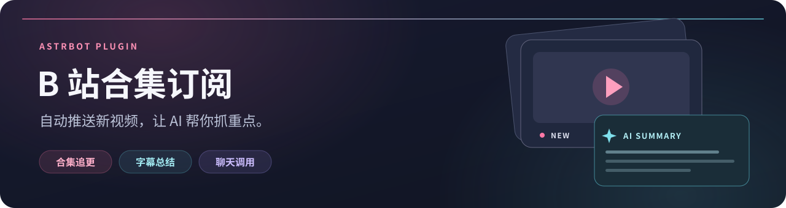

<div align="center">



#  AstrBot · B 站合集订阅

**订阅你关注的合集，新视频自动送达。想抓重点？直接让 AI 总结。**

[](metadata.yaml)
[](https://docs.astrbot.app/)
[](#直接聊天总结)
[](LICENSE)

[快速开始](#快速开始) · [管理控制台](#管理控制台) · [聊天总结](#直接聊天总结) · [全部指令](#全部指令) · [配置说明](#配置说明) · [常见问题](#常见问题)

</div>

---

## 你可以用它做什么

| 功能 | 使用体验 |
| :--- | :--- |
| 📺 **合集追更** | 定时检查合集，发现新视频后下载并推送；先发标题，再发视频 |
| ✨ **字幕总结** | 优先读取 B 站字幕生成中文摘要，并明确标注资料来源 |
| 🎙️ **无字幕转写** | 可选提取音讯，用 AstrBot STT 模型转成文字后总结；缓存转写以减少重复识别 |
| 🎭 **接梗短评** | 适度接住 UP 主的标题梗；可选联网查相关新梗，最多补一句短评和一条参考 |
| 🖥️ **管理控制台** | 在 AstrBot 内查看运行状态、管理订阅、调整配置与查看检查记录 |
| 💬 **聊天调用** | 对支持工具调用的模型说“总结一下最近一期视频”，由模型调用插件 |
| 🔁 **失败重试** | 下载或视频发送失败进入待重试列表，也能手动重试 |
| ⚙️ **按需下载** | 设置清晰度、时长、大小与文件保留时间 |
| 👥 **会话订阅** | 同一合集可被多个会话订阅；AI 工具只读取当前会话的订阅 |

> [!IMPORTANT]
> **聊天总结、手动总结、自动推送总结是三种用法。**
> `summary_enabled` 只控制“新视频推送后自动发摘要”，默认关闭。聊天工具和手动指令不需要开启它。

## 快速开始

### 1 · 安装插件

在 AstrBot 插件管理中，从 GitHub 仓库或插件 ZIP 安装：

```text
https://github.com/xureimu-bit/astrbot_plugin_bilibili_season_subscribe
```

也可以将插件文件夹放入 AstrBot 插件目录，安装 `requirements.txt` 中的依赖，启用并重载插件。

- **依赖：** `httpx>=0.27,<1`
- **建议：** AstrBot 4.5.7 或更新版本；聊天总结需使用支持工具调用的模型
- **视频下载：** 建议安装 `ffmpeg`；音视频分离流需要它来合并。不在系统路径中时，填写 `ffmpeg_path`

### 2 · 添加一个合集

在希望接收推送的聊天中发送：

```text
/bili合集订阅 添加 https://space.bilibili.com/1865348651/lists/5193004?type=season
/bili合集订阅 列表
```

上面的合集仅作为链接格式示例，请替换成你要订阅的合集。

<details>
<summary>支持哪些合集链接？</summary>

```text
https://space.bilibili.com/<mid>/lists/<season_id>?type=season
https://space.bilibili.com/<mid>/channel/collectiondetail?sid=<season_id>
```

当前支持空间合集（Season／列表）链接。

</details>

### 3 · 选择你的总结方式

| 你想做什么 | 怎么用 |
| :--- | :--- |
| **聊一句，让 AI 找最新一期** | 启用本插件的 AI 工具，对模型说“总结一下最近一期视频” |
| **总结一条指定视频** | 发送 `/bili合集订阅 总结 <BV号或完整视频链接>` |
| **每次追更都附上摘要** | 开启插件配置中的 `summary_enabled`，保存并重载 |

> [!TIP]
> 首次订阅默认**只追踪之后的新增视频**，不会一次推送全部历史内容。
> 如需连同历史视频发送，订阅前将 `notify_on_first_subscribe` 设为 `true`。

## 直接聊天总结

安装／更新后重载插件，在 AstrBot 中启用本插件及其工具，再使用支持 **Function Calling／工具调用** 的聊天模型。

你可以直接说：

> 💬 总结一下最近一期视频。
>
> 💬 总结我订阅的 XX 合集最新一期。
>
> 💬 帮我总结这个视频：https://www.bilibili.com/video/BV号

**只有一个订阅合集时自动选择；有多个合集时请指定合集名称。** 名称匹配不唯一时，工具会返回选项，让模型向你确认。

“最近一期”按 B 站列表返回的**发布时间**选择，不按排列顺序猜测。列表缺少有效时间时，会要求提供具体视频。没有订阅时，可以先添加合集，或直接提供视频 BV 号／链接。

<details>
<summary>查看注册到 AstrBot 的三个 AI 工具</summary>

| 工具 | 用途 |
| :--- | :--- |
| `bili_list_subscribed_seasons` | 列出当前会话订阅的合集，帮助选择 |
| `bili_summarize_latest_video` | 总结合集最新一期；支持名称、`season_id` 或 `mid:season_id`，未指定时传空字符串 |
| `bili_summarize_video` | 总结用户提供的 BV 号或完整视频链接 |

工具通过 `@filter.llm_tool` 注册，返回结果交给当前聊天模型组织回复。
它们不下载／发送视频，也不修改已处理、待重试等订阅状态。
是否自动调用取决于模型能力和 AstrBot 工具配置；不支持工具调用时仍可使用手动指令。
模型的工具执行超时应给 `summary_timeout_seconds` 留出余量。

</details>

## 全部指令

| 指令 | 作用 |
| :--- | :--- |
| `/bili合集订阅 添加 <合集链接>` | 将当前会话加入合集订阅 |
| `/bili合集订阅 删除 <season_id>` | 取消本会话的订阅，不影响其他会话 |
| `/bili合集订阅 列表` | 查看本会话订阅及待重试数量 |
| `/bili合集订阅 检查` | 立即检查本会话的合集，处理新增及待重试视频 |
| `/bili合集订阅 重试 [season_id或全部]` | 重试指定合集；不带参数则重试本会话全部待处理项 |
| `/bili合集订阅 总结 <BV号或视频链接>` | 手动总结指定影片，无需先订阅 |

```text
/bili合集订阅 检查
/bili合集订阅 重试 5193004
/bili合集订阅 总结 https://www.bilibili.com/video/BV1xx411c7mD
```

BV 号仅为格式示例，请替换成实际视频。暂不支持 `b23.tv` 短链接。

## 没有字幕也能总结（v1.4.0）

开启语音转写后，资料顺序是 **B 站字幕 → 语音转写 → 标题／简介概述**。
有可取得的字幕时不会调用 STT；字幕不可取得时才下载音轨、提取单声道音讯并分段识别。
英文原声也可交给支持英文的 STT，再由 DeepSeek 等聊天模型生成中文摘要。

### 先配置一个语音识别模型

一个可选的接法是硅基流动的 `FunAudioLLM/SenseVoiceSmall`：

1. 在 [硅基流动控制台](https://cloud.siliconflow.cn/)建立 API Key。
2. 在 AstrBot 的语音识别／STT 提供商中新增 **OpenAI Whisper API**（兼容接口）。
3. API Base 填 `https://api.siliconflow.cn/v1`，模型填 `FunAudioLLM/SenseVoiceSmall`，API Key 填硅基流动的 Key。
4. 在插件配置中选择该 STT 的 `asr_provider_id`，开启 `asr_enabled`，保存并重载；DeepSeek 仍负责文字总结。

接口字段依据 [AstrBot 官方实现](https://github.com/AstrBotDevs/AstrBot/blob/master/astrbot/core/provider/sources/whisper_api_source.py) 与 [硅基流动接口文档](https://docs.siliconflow.cn/docs/api/audio-transcriptions-post)。服务价格以供应商为准，不能套用另一家的报价。
也可选择其他兼容的云端 STT，或 AstrBot 支持的本地 Whisper／Xinference。API Key 保存在 AstrBot 提供商配置中，插件不另存 Key。

> [!IMPORTANT]
> 语音转写需要 **ffmpeg**，会比字幕摘要慢。默认转写预算 300 秒，加摘要预算 60 秒；聊天模型的工具执行超时建议设为 **至少 400 秒**，否则 AstrBot 可能提前取消任务。
> 转写默认关闭；启用后音讯分段会发送给你选择的 STT 服务，并可能按该服务规则计费。

转写最长默认 20 分钟，每段 2 分钟。超过时长／下载大小上限、没有 STT、提取失败、超时或识别返回空文字时，会明确降级为标题／简介概述；不会把不完整转写当作全文，也不会因摘要失败重推已发视频。
完整转写缓存 7 天，最多 200 条，按 BV 号、第 1 P 的 cid、STT 提供商及模型区分。重复总结会复用转写，但仍需一次新的文字摘要调用。

## 配置说明

在 AstrBot 插件配置中修改，保存后重载插件。默认配置保留原有视频推送行为。

### ✨ AI 总结

| 配置项 | 默认值 | 说明 |
| :--- | :---: | :--- |
| `summary_enabled` | `false` | 视频推送成功后是否另发 AI 摘要；不影响聊天工具／手动总结 |
| `summary_provider_id` | 空 | 留空使用接收会话当前聊天模型；可填 AstrBot 的 **Provider ID**，不是模型名或 API Key |
| `summary_timeout_seconds` | `60` | 单次总结整体超时，含资料获取与模型生成；范围 5–300 秒 |
| `summary_max_input_chars` | `12000` | 输入资料字符上限，不含提示词及 JSON 包装；范围 500–50000 |
| `summary_max_output_chars` | `250` | 摘要正文字符上限；范围 100–4000，含摘要截断提示，不含标题、链接与来源说明 |

摘要采用“一句话概述＋最多三条要点”，正文尽量在 200 字以内；超过输出上限时优先在完整句末截断。
从旧版升级不会覆盖已保存的设置：如果后台的 `summary_max_output_chars` 仍为 `800`，可改为 `250`，想更短可设 `150`。
通过聊天工具调用时也会提示聊天模型简短转述，保留来源与链接。

### 💬 标题梗与联网热梗

摘要会适度保留 UP 主标题里的双关、反差或自嘲，顺着标题接梗；夸张标题不会当作视频事实，不懂的梗也不会硬编。

需要最新梗参考时：

1. 在 AstrBot **当前聊天使用的配置文件 → AI → 能力 → 网页搜索** 中启用搜索，选择服务并按需填写 Key。
2. 在本插件配置里开启 `meme_enabled`，保存并重载插件。
3. 照常说“总结最近一期视频”，或等待订阅自动推送。只有取得字幕／STT 正文后才联网查询。

插件先完成视频摘要，再使用少量标题和摘要关键词查找相关梗；资料明确相关且长度允许时，最多补一句 40 字以内的“短评”，附一条“梗参考”链接。
短评计入 `summary_max_output_chars`；事实优先，不会为塞入短评而删减摘要。没有合适资料、搜索关闭／超时／失败时，照常发送普通总结。

| 配置项 | 默认值 | 说明 |
| :--- | :---: | :--- |
| `meme_enabled` | `false` | 可选联网热梗短评；标题幽默无需开启联网 |
| `meme_timeout_seconds` | `15` | 搜索与短评共享的额外时间预算，范围 3–45 秒；超时降级 |
| `meme_cache_hours` | `6` | 搜索结果内存缓存时长，范围 0–24 小时；`0` 关闭，重载清空，最多 128 条 |

复用 AstrBot 的 Tavily、BoCha、Brave、Firecrawl、百度 AI 搜索、Exa 或 AnySearch 配置；只使用该会话已启用的服务，不另存 Key。AnySearch 无 Key 时也需先在 AstrBot 里显式选择并启用。
适配 AstrBot 4.28.2 的内置搜索接口；旧版缺少接口时自动降级，普通总结仍可用。Tavily、BoCha、Brave、百度及 Exa 请求约一个月内资料；Firecrawl／AnySearch 使用带当前年月的查询，不保证日期过滤。
搜索结果可能过时，检索时间不代表梗的流行日期，不保证每条视频都能找到新梗。

搜索按会话、服务、Key 指纹和查询缓存，命中后无需重复搜索；网络请求失败不缓存，模型短评不持久化。
未命中缓存时会调用所选搜索服务；有参考资料时最多额外调用一次当前总结模型，只传短摘要与限长搜索片段，不会再次传完整字幕／转写。
搜索查询最长 72 字，不传聊天记录、会话身份或完整字幕，仅使用公开视频的少量标题／摘要；搜索服务可能计费，使用其在 AstrBot 中配置的账号额度。

[AstrBot 网页搜索配置说明](https://docs.astrbot.app/use/websearch.html)

### 🎙️ 无字幕语音转写

| 配置项 | 默认值 | 说明 |
| :--- | :---: | :--- |
| `asr_enabled` | `false` | 字幕不可取得时是否调用 STT；与 `summary_enabled` 独立 |
| `asr_provider_id` | 空 | 已配置的 AstrBot STT Provider ID；留空选择当前会话的 STT 模型 |
| `asr_timeout_seconds` | `300` | 排队、下载、提取及所有分段识别的整体预算；范围 30–1800 秒 |
| `asr_max_duration_seconds` | `1200` | 最长转写时长；范围 60–7200 秒，超过上限不转写 |
| `asr_chunk_seconds` | `120` | 每次识别一段的秒数；范围 30–300 |
| `asr_max_download_mb` | `40` | 媒体下载大小上限；范围 1–200 MB |
| `asr_cache_hours` | `168` | 完整转写文字保存小时数；范围 0–720，`0` 不缓存 |

### 📺 订阅与下载

| 配置项 | 默认值 | 说明 |
| :--- | :---: | :--- |
| `poll_interval_minutes` | `20` | 轮询间隔，单位分钟 |
| `max_video_height` | `720` | 最大清晰度高度，`0` 为不限 |
| `max_duration_seconds` | `1800` | 最大时长，单位秒，`0` 为不限 |
| `max_filesize_mb` | `80` | 最大文件大小，单位 MB，`0` 为不限 |
| `retain_download_hours` | `24` | 文件保留小时数；`0` 发完删除，`-1` 长期保留 |
| `notify_on_first_subscribe` | `false` | 首次订阅时是否把已有视频也纳入推送 |

<details>
<summary>🔧 接口、编码与登录态配置</summary>

| 配置项 | 默认值 | 说明 |
| :--- | :---: | :--- |
| `request_timeout_seconds` | `15` | B 站请求超时，单位秒 |
| `page_size` | `30` | 合集接口分页大小 |
| `preferred_video_codec` | `avc` | 优先编码关键字，如 `avc`、`h264`、`hevc` |
| `preferred_ext` | `mp4` | 优先输出容器，如 `mp4`、`mkv` |
| `ffmpeg_path` | 空 | 留空自动查找，或填写 ffmpeg 路径 |
| `bilibili_sessdata` | 空 | 可选 B 站登录态；遇到 `412` 或字幕需要登录时可尝试填写 |
| `bilibili_cookie_file` | 空 | 可选 Netscape 格式 `cookie.txt` 文件路径 |

播放器接口复用已有 B 站 Cookie 配置；字幕 CDN 请求不携带登录 Cookie。

</details>

## 总结的范围与来源

**B 站字幕／语音转写 → AstrBot 配置的聊天模型 → 中文摘要。**

- 优先读取中文字幕，同语言内优先人工字幕，最多尝试三条字幕。
- 字幕不可取得时，可由已启用的 STT 转写音讯，标明“语音转写（自动识别，可能有误）”；未启用或转写失败时标明“仅标题／简介”。不分析画面，也不读取 B 站 AI 小助手的现成总结。
- 多 P 视频与现有下载范围一致，**只处理第 1 P**；即使链接有 `?p=2` 也一样，摘要会注明范围。
- 超长资料截取部分并标明“资料已截断”；自动字幕可能有识别错误。
- 自动推送摘要按**每个成功发送的视频**生成，不合并整次更新或整个合集；下载失败、超出下载限制而跳过的视频不触发自动摘要。
- 推送顺序为 **标题 → 视频（或文件／文本回退）→ 摘要**。摘要失败不使已发视频重新进入重试。
- 视频标题、简介、字幕或转写文字会发给所选聊天模型；启用转写时音讯还会交给所选 STT，可能分别产生费用。

## 管理控制台

更新到 1.6.0 后重载插件，在 AstrBot 的**插件 → B站合集订阅详情 → B站合集控制台**打开页面；支持固定插件页面的 WebUI 可将其固定到侧栏。
控制台基于 AstrBot 4.28.2 的 Plugin Pages 与登录接口，无需额外启动服务器或填写另一份密码。需要支持 Plugin Pages 的核心与 Dashboard；旧版仍可使用聊天指令和原配置面板。

| 页面 | 可以做什么 |
| :--- | :--- |
| 运行概览 | 查看合集、推送会话、待重试、已处理数量，近 14 天检查活动及功能开关状态 |
| 订阅管理 | 查看订阅，在已有会话中新增合集，移除指定会话的订阅 |
| 配置中心 | 分组调整总结、STT、热梗、下载与轮询配置；自动列出聊天／STT 模型 |
| 检查记录 | 查看实际检查结果、类型和耗时，启动重试任务 |

- 首次绑定新会话仍在目标聊天中执行 `/bili合集订阅 添加 <合集链接>`。管理页不向任意输入的会话新增推送。
- “立即检查”和“重试待处理”会按既有订阅与筛选配置推送视频及摘要，点击前有确认提示。
- 配置保存后直接应用；正在检查时先等待任务结束。修改轮询间隔不会打断当前等待，下个周期使用新间隔。
- SESSDATA 不回传到页面；密码框留空保留旧值，勾选清除才会删除。搜索服务的 Key 仍由 AstrBot 管理。
- 页面会检测配置冲突；如果原配置面板同时修改了配置，请重新读取后再保存。
- 检查串行执行，避免手动检查与自动轮询重复推送。检查记录保存在 `dashboard_history.json`，最多 200 条，图表仅统计这些真实记录。
- “已处理”包含已发送和按规则跳过的视频；目前未采集 Token 或费用数据，因此不显示这类统计。
- 页面支持深浅主题和窄屏表单；主题由 AstrBot 同步。

## 常见问题

<details>
<summary>为什么说“总结最新一期”，模型没有调用插件？</summary>

确认已更新到 1.3.1 或之后的版本并重载插件；当前聊天模型需支持工具调用，AstrBot 中也要启用本插件及相关工具。
`summary_enabled` 不控制聊天工具。可以先用 `/bili合集订阅 总结 <BV号>` 验证摘要功能。

</details>

<details>
<summary>为什么只有标题／简介概述，没有字幕全文总结？</summary>

字幕可能要求登录、尚未生成，或接口不可用。可尝试有效的 `bilibili_sessdata` 或 Cookie 文件，但不能保证每条视频都有可读取的字幕。
也可以配置 STT、ffmpeg 并开启 `asr_enabled`，让插件转写原声音讯。影片画面上的硬字幕不等于 B 站可读取的 CC 字幕；本插件不对画面做 OCR。

</details>

<details>
<summary>语音转写提示“媒体地址不属于支持的 B 站 CDN”怎么办？</summary>

更新到 1.4.2 或之后的版本并重载插件。此错误发生在音轨下载阶段，尚未调用 STT。
新版支持 B 站接口返回的 Akamai 海外音轨域名及 mcdn 的 4483 端口；HTTP 音轨地址会先升级为 HTTPS。
首个地址不可用时会尝试备用地址及其他码率音轨，最多发起 3 次下载。
仍失败时请查看日志中的具体原因。其他插件的语音识别功能只有接入 AstrBot 的 STT Provider 后，才能由本插件复用。

</details>

<details>
<summary>下载失败、报 412，或者视频没有发出来怎么办？</summary>

遇到 `HTTP 412` 时优先尝试有效的 B 站登录态或 Cookie 文件。
音视频分离流需要 `ffmpeg`；同时确认适配器允许主动消息，并支持本地视频／文件上传。
失败项会进入下一轮重试，也可以执行 `/bili合集订阅 重试`。

</details>

<details>
<summary>订阅数据和下载文件存在哪里？</summary>

位于插件自身的数据目录：`subscriptions.json` 保存订阅，`downloads/` 保存下载文件。
`transcripts/` 保存完整转写快取，过期及超额记录在写入新快取时清理；`asr_temp/` 用于单次任务，任务结束／失败／取消时删除该任务的音讯文件。
删除本会话订阅不影响其他会话；最后一个订阅者删除后，合集记录才会清理。

</details>

<details>
<summary>开发说明与验证</summary>

下载采用 B 站接口解析与直链下载，不直接依赖 `yt-dlp`。
摘要优先使用 AstrBot 的 `get_current_chat_provider_id` / `llm_generate`；旧版缺少 `llm_generate` 时回退到 Provider 的 `text_chat`。
独立摘要生成不读写聊天历史，也不提供工具，避免递归调用。
转写与联网热梗均关闭时，同次发送中同 Provider 复用摘要；任一启用时按会话分隔资料，避免混用不同 STT 或搜索设置。
摘要结果不持久化保存；完整语音转写按 `asr_cache_hours` 保存，可设为 `0` 关闭。

安装 `requirements.txt` 后运行：

```text
python -m unittest discover -s tests -v
python -m compileall -q main.py summarization.py transcription.py meme_context.py dashboard.py
```

离线测试使用真实 `httpx` 的模拟传输，AstrBot 平台和 LLM 边界使用替身。
真实字幕登录态、模型自动工具选择及适配器上传能力需在部署环境验证。
B 站网页接口未来可能调整，届时可能需要同步更新插件。

[AstrBot 官方 AI 接口文档](https://docs.astrbot.app/dev/star/guides/ai.html) · [版本更新记录](RELEASE_NOTES.md)

</details>

---

<div align="center">

**追更少一步，重点看得快。**

由 [xureimu-bit](https://github.com/xureimu-bit) 维护 · [MIT License](LICENSE)

</div>
